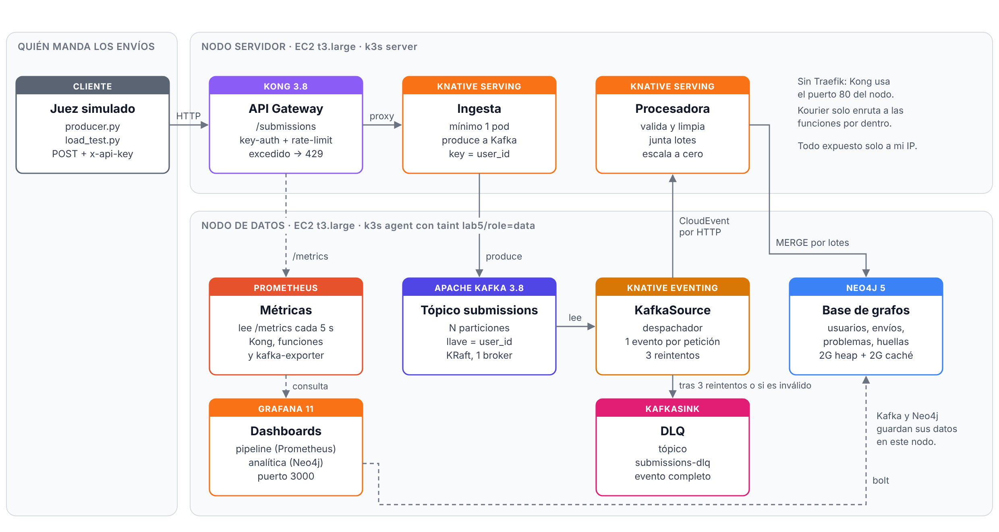

# Ingesta en streaming de un juez en línea: Kong + Kafka + Knative + Neo4j + Grafana en k3s con Terraform

> Sistemas Escalables — ITESO
> Autor(es): Victor Sebastian Sanchez Silva
> Fecha: 2026-10-19

Versión open source de [`AWS_5`](../AWS_5): el mismo pipeline, con las mismas pruebas, sobre un clúster de **k3s** de dos nodos `t3.large`: uno para las aplicaciones y otro para los datos. El juez manda cada envío calificado a **Kong**, protegido con **API key**. Una función de **Knative** lo publica en **Apache Kafka**. Un **KafkaSource** de Knative Eventing entrega cada registro a otra función de Knative, que lo valida, lo limpia y lo carga en **Neo4j**. **Prometheus** y **Grafana** muestran el estado del pipeline y las analíticas.

---

## Tabla de contenidos
- [Objetivo](#objetivo)
- [Arquitectura](#arquitectura)
- [Tecnologías](#tecnologías)
- [Requisitos previos](#requisitos-previos)
- [Estructura del proyecto](#estructura-del-proyecto)
- [Configuración](#configuración)
- [Despliegue / Ejecución](#despliegue--ejecución)
- [Verificación](#verificación)
- [Resultados](#resultados)
- [Limpieza de recursos](#limpieza-de-recursos)
- [Problemas conocidos](#problemas-conocidos)
- [Referencias](#referencias)

---

## Objetivo
Lo mismo que `AWS_5`, pero solo con software open source: recibir un volumen grande de peticiones, procesarlas en streaming desde un tópico y guardarlas en una base de datos con visualización, todo con Terraform y sin pasos manuales.

- Exponer una **API** (`POST /submissions`) protegida con API key y con límites de tráfico (**Kong**).
- Publicar cada envío en un tópico (**Kafka**), con la llave por usuario para conservar el orden de sus envíos.
- Procesarlos con una función serverless (**Knative**) solo para validar y limpiar, y cargarlos en una base de grafos (**Neo4j**).
- Mandar a una cola de fallas (un tópico DLQ) lo que no se pueda procesar, sin frenar el resto.
- Visualizar el pipeline y los datos en **Grafana**, con las métricas en **Prometheus**.
- Demostrar que el despliegue **atiende muchas peticiones sin degradarse**, con la misma prueba de carga por escalones.
- Poder destruir y recrear el entorno en cada sesión sin dejar recursos.

## Arquitectura
<!-- Agrega aquí tu diagrama:  -->

El juez (en el lab, `tests/producer.py` o `tests/load_test.py`) calcula las huellas del código para detectar plagio y manda cada envío a Kong con el encabezado `x-api-key`. Kong revisa la key y el límite de tráfico, y reenvía la petición a la **función de ingesta**, que publica cada envío en Kafka con el `user_id` como llave. El **KafkaSource** lee el tópico con un grupo de consumidores y manda cada registro como un CloudEvent por HTTP a la **función procesadora**. La procesadora junta los eventos que le llegan al mismo tiempo, los valida, los limpia y escribe cada lote en Neo4j con `MERGE`, que es idempotente porque Kafka entrega "al menos una vez". Si la procesadora falla, el KafkaSource reintenta; los eventos inválidos y los que agotan sus reintentos terminan en el tópico DLQ. Prometheus lee las métricas de todas las piezas y Grafana las grafica.

```
                          ┌──────────── server · t3.large ─────────────┐   ┌──── data · t3.large ────┐
Juez ── POST + x-api-key ─┼─► Kong :80 ──► ingest ───────────────────────┼──►│ Kafka                   │
(producer.py,             │   (key-auth,   (Knative)                     │   │ (N particiones,         │
 load_test.py)            │    rate-limit,                               │   │  llave = user_id)       │
                          │    429)       KafkaSource ◄──────────────────┼───┤                         │
                          │               (Knative Eventing,             │   │                         │
                          │                1 evento por petición)        │   │                         │
                          │                    │                         │   │                         │
                          │                    ▼                         │   │                         │
                          │               processor ── lotes (MERGE) ────┼──►│ Neo4j :7474 / :7687     │
                          │               (Knative)                      │   │                         │
                          │                    │ tras 3 reintentos       │   │                         │
                          │                    ▼ o evento inválido       │   │                         │
                          │               KafkaSink ─────────────────────┼──►│ submissions-dlq         │
                          │                                              │   └─────────────────────────┘
                          │   Prometheus :9090 ◄── /metrics de Kong, ingest, processor y kafka-exporter
                          │   Grafana :3000 ── Prometheus + Neo4j (bolt)  │
                          └──────────────────────────────────────────────┘
Navegador, SSH y scripts de tests/ entran por la IP pública del servidor (solo desde tu IP)
```

Equivalencias con `AWS_5`:

| `AWS_5` | `k3s_5` | Diferencia |
|---|---|---|
| API Gateway + API key + usage plan | **Kong** (plugins `key-auth` y `rate-limiting`) | Sin key responde `401` en vez de `403`. No hay límite de ráfaga |
| Lambda de ingesta | Knative Service `ingest` | Siempre con 1 pod como mínimo |
| Kinesis (N shards) | **Kafka** con un tópico de N particiones | Un shard aguanta ~340 envíos/s; una partición, mucho más |
| Event Source Mapping | **KafkaSource** | Entrega **un evento por petición**, no lotes. La procesadora arma los lotes |
| Lambda procesadora | Knative Service `processor` | Escala a cero, como Lambda |
| SQS (DLQ) | Tópico `submissions-dlq`, escrito por un **KafkaSink** | Guarda el evento completo, no solo sus metadatos |
| CloudWatch | **Prometheus** + kafka-exporter | El lag se mide en registros, no en milisegundos |
| Neo4j y Grafana en Docker | Neo4j y Grafana como pods | — |

Modelo del grafo (igual que en `AWS_5`, mismo Cypher):
```
(:User)-[:SUBMITTED]->(:Submission)-[:FOR]->(:Problem)
(:Submission)-[:IN]->(:Language)
(:Submission)-[:GOT]->(:Verdict)
(:User)-[:SOLVED]->(:Problem)              al primer Accepted
(:Submission)-[:HAS]->(:Fingerprint)       huellas del código (plagio)
```

### Cómo se despliega
AWS Academy solo permite instancias hasta `large`, así que el clúster se reparte en dos `t3.large` (2 vCPU y 8 GB cada una):

| Nodo | Qué corre | Cómo se logra |
|---|---|---|
| `server` | k3s server, Knative Serving y Eventing, Kong y las dos funciones | Etiqueta `lab5/role=apps` |
| `data` | Kafka, Neo4j, el despachador del KafkaSource (el consumidor de Kafka), Prometheus, Grafana y kafka-exporter | Etiqueta y *taint* `lab5/role=data`: solo se programan ahí los pods que lo toleran |

Los componentes de Knative reservan casi los 2 vCPU del servidor con sus valores de fábrica, así que `deploy.sh` baja algunas reservas (`requests`, no los límites) y manda al nodo de datos todo lo que no necesita la imagen local de las funciones.

La imagen de las funciones se construye en el servidor; como el taint no las deja ir al nodo de datos, no hace falta copiarla. Todo se expone en la IP pública del servidor.

Hay dos fases, para que cambiar una variable no recree las EC2:

1. **`user_data`** (una sola vez por instancia, de 6 a 10 minutos):
   - en el servidor (`scripts/user_data.sh.tftpl`): Docker, k3s server sin Traefik, Knative Serving con Kourier, Knative Eventing y el soporte de Kafka (KafkaSource y KafkaSink);
   - en el nodo de datos (`scripts/user_data_agent.sh.tftpl`): k3s agent, que se une solo al servidor con un token que genera Terraform.
2. **`deploy.sh`** (`scripts/deploy.sh.tftpl`, cada vez que cambias algo): Terraform entra por SSH al servidor con el `.pem` que generó, sube `src/` y `k8s/` y corre el script, que:
   - espera a que el nodo de datos esté listo;
   - construye la imagen de las funciones;
   - aplica los manifiestos de `k8s/`;
   - crea los tópicos;
   - ajusta el KafkaSource, Kong y el dashboard.

   Cuando `terraform apply` termina, el pipeline ya responde.

Recursos que crea Terraform:
- **Dos instancias EC2** `t3.large` (`server` y `data`) con la AMI más reciente de Amazon Linux 2023 y 30 GB de disco cada una, en la misma subred.
- **Security Group** compartido: abre 22, 80, 3000, 7474, 7687 y 9090 **solo desde tu IP pública**, detectada en cada `apply`, y todo el tráfico entre los dos nodos (API de k3s, red de pods y kubelet).
- **Token de k3s** aleatorio para que el agente se una al servidor.
- **Key Pair** generado automáticamente; el `.pem` se guarda en `infra/` con permisos restringidos a tu usuario.
- **API key** y **contraseñas aleatorias** para Neo4j y Grafana.
- La configuración de Kong, el dashboard del pipeline y el despliegue por SSH (`terraform_data`).

Dentro de k3s (`k8s/`):

| Manifiesto | Qué crea |
|---|---|
| `namespaces.yaml` | Namespaces `judge` (pipeline) y `monitoring` |
| `kafka.yaml` | Broker de Kafka 3.8 en modo KRaft (StatefulSet con disco, en el nodo `data`) |
| `neo4j.yaml` | Neo4j 5.26 (StatefulSet con disco, en el nodo `data`), puertos 7474 y 7687 |
| `kong.yaml` | Kong 3.8 sin base de datos, puerto 80 |
| `ingest.yaml` | Knative Service `ingest` (solo red interna) |
| `processor.yaml` | Knative Service `processor` (solo red interna) |
| `kafka-source.yaml` | KafkaSink `dlq` y KafkaSource `submissions` |
| `kafka-exporter.yaml` | Offsets y lag de Kafka para Prometheus |
| `prometheus.yaml` | Prometheus que lee los pods con la anotación `prometheus.io/scrape`, puerto 9090 |
| `grafana.yaml` | Grafana con Prometheus y el dashboard ya configurados, puerto 3000 |

### Contrato del evento
El mismo de `AWS_5`: un objeto JSON por envío, o un arreglo de hasta 500 en `/submissions/batch`.

```json
{"submission_id": "s123", "user_id": "u45", "problem_id": "p00001", "language": "Python",
 "verdict": "Wrong Answer", "cpu_ms": 120, "memory_kb": 9000, "code_size": 665,
 "date": 1500000000, "fps": ["0a3f9c21be47", "1b07e5d2c9aa"], "run_id": "opcional"}
```

Respuestas de la API: `202` aceptado, `400` petición inválida, `401` sin API key válida, `429` límite de Kong excedido, `503` Kafka sin capacidad (reintentar). En `/submissions/batch`, la respuesta `202` trae `accepted` y la lista `failed` con los índices que hay que reintentar. En `/submissions`, la respuesta `202` trae `partition` y `offset` (en AWS eran `shard_id` y `sequence_number`).

La ingesta agrega `arrival_ms` (cuándo entró a Kafka), que la procesadora guarda para medir la latencia de extremo a extremo.

## Tecnologías
| Herramienta | Versión | Uso |
|-------------|---------|-----|
| Terraform | >= 1.5 | Infraestructura como código |
| AWS provider | 5.x | EC2, Security Group, Key Pair |
| random / tls / local / http providers | 3.x / 4.x / 2.x / 3.x | API key y contraseñas, llave SSH, `.pem` y detectar tu IP |
| k3s | estable | Kubernetes de dos nodos (server + agent) |
| Knative Serving + Kourier | 1.16 | Funciones serverless (equivale a Lambda) |
| Knative Eventing + eventing-kafka-broker | 1.16 | KafkaSource y KafkaSink (equivalen al Event Source Mapping y la DLQ) |
| Apache Kafka | 3.8 (KRaft) | Tópico de ingesta |
| Kong Gateway (OSS) | 3.8 | Entrada del juez, API key y límite de tráfico |
| Python + confluent-kafka + gunicorn | 3.12 | Funciones de ingesta y procesamiento |
| Neo4j | 5.26 Community | Base de datos de grafos |
| Prometheus + kafka-exporter | 2.54 / 1.8 | Métricas (equivale a CloudWatch) |
| Grafana | 11.2.0 OSS | Visualización (Prometheus + plugin `kniepdennis-neo4j-datasource`) |
| Python | 3.10+ | Scripts de prueba (solo biblioteca estándar) |
| Git Bash | — | Terminal para correr Terraform, SSH y los scripts |

## Requisitos previos
- Terraform instalado (`terraform --version`).
- AWS CLI configurado con el perfil `academy` (`aws sts get-caller-identity --profile academy`).
  Si no lo tienes: `aws configure --profile academy`.
- Python 3.10 o superior (`python --version`). Los scripts de `tests/` no necesitan paquetes extra.
- **Bash**: en Windows, [Git Bash](https://git-scm.com/downloads); en Linux o Mac, la terminal normal. Los pasos automáticos de permisos del `.pem` y de limpieza de `known_hosts` usan `bash`.
- En Windows, **corre Terraform desde Git Bash**, no desde PowerShell ni CMD, para que `bash` apunte al de Git y no al de WSL.

## Estructura del proyecto
```
k3s_5/
├── infra/                     # Código Terraform (aquí se corren los comandos)
│   ├── versions.tf            # Versión de Terraform y de los providers
│   ├── providers.tf           # Provider de AWS con el perfil academy
│   ├── variables.tf           # Variables configurables
│   ├── outputs.tf             # URLs, API key, contraseñas, SSH y lo que leen los tests
│   ├── network.tf             # VPC por defecto, detección de tu IP y Security Group
│   ├── k3s.tf                 # EC2 server y data, token de k3s, Key Pair, .pem y known_hosts
│   ├── kong.tf                # API key y configuración de Kong (≈ apigw.tf)
│   ├── kafka.tf               # Nombres del tópico, la DLQ y el grupo (≈ kinesis.tf + sqs.tf)
│   ├── knative.tf             # Imagen y ajustes de las funciones (≈ lambda.tf)
│   ├── neo4j.tf               # Contraseña de Neo4j
│   ├── grafana.tf             # Contraseña de Grafana y dashboard del pipeline (Prometheus)
│   └── deploy.tf              # Despliegue por SSH: sube src/ y k8s/ y corre deploy.sh
├── k8s/                       # Manifiestos de Kubernetes (ver tabla de arriba)
├── scripts/
│   ├── user_data.sh.tftpl     # Servidor: instala k3s, Docker, Knative y el soporte de Kafka
│   ├── user_data_agent.sh.tftpl # Nodo de datos: k3s agent con la etiqueta y el taint lab5/role=data
│   └── deploy.sh.tftpl        # Construye la imagen, aplica k8s/, crea tópicos y ajusta parámetros
├── src/                       # Código de las funciones (una sola imagen)
│   ├── ingest.py              # Ingesta: Kong -> Kafka
│   ├── handler.py             # Procesadora: valida, limpia, junta lotes y carga en Neo4j
│   ├── neo4j_http.py          # Cliente HTTP de Neo4j con reintentos (igual que en AWS_5)
│   ├── Dockerfile
│   └── requirements.txt
├── tests/                     # Lo que ejecutas tú (mismos scripts que AWS_5)
│   ├── requirements.txt       # Vacío: solo biblioteca estándar
│   ├── common.py              # Outputs de Terraform y clientes de Neo4j, la API y Prometheus
│   ├── synthetic.py           # Generador de envíos (igual que AWS_5)
│   ├── fingerprint.py         # Huellas de código para plagio (igual que AWS_5)
│   ├── producer.py            # Simula al juez: genera envíos, calcula huellas y los manda
│   ├── load_test.py           # Prueba de carga de la API por escalones de clientes
│   ├── db.py                  # Neo4j: wait, stats, reset (igual que AWS_5)
│   ├── metrics.py             # Latencia, throughput y métricas de Prometheus de una corrida
│   ├── queries.py             # Analíticas de grafo y detección de plagio (igual que AWS_5)
│   └── results/               # (generado) resultados de cada corrida y experiments.csv
└── README.md
```

## Configuración
Todas las variables tienen valor por defecto, así que no hace falta un archivo `.tfvars`.

| Variable | Descripción | Valor por defecto | Equivale en `AWS_5` |
|----------|-------------|-------------------|---------------------|
| `aws_profile` | Perfil de AWS CLI | `academy` | igual |
| `aws_region` | Región de AWS | `us-east-1` | igual |
| `project_name` | Prefijo de los recursos | `judge-stream-k3s` | `project_name` |
| `instance_type` | Tipo del servidor de k3s (Academy no permite más que `large`) | `t3.large` | `instance_type` |
| `data_instance_type` | Tipo del nodo de datos (Kafka y Neo4j) | `t3.large` | — |
| `partitions` | Particiones del tópico (cambiarlo recrea el tópico) | `1` | `shards` |
| `consumers` | Consumidores del KafkaSource | `1` | — |
| `ordering` | `ordered` (un evento a la vez por partición) o `unordered` (varios en vuelo) | `unordered` | `parallelization_factor` |
| `max_poll_records` | Registros por poll del despachador; en `unordered` limita los eventos en vuelo | `50` | — |
| `batch_size` | Máximo de envíos por transacción en Neo4j | `100` | `batch_size` |
| `batching_window` | Segundos que la procesadora espera para llenar el lote | `0` | `batching_window` |
| `processor_memory` | Memoria de cada pod de la procesadora en MB | `256` | `lambda_memory` |
| `processor_concurrency` | Eventos simultáneos por pod antes de agregar otro | `100` | — |
| `processor_min_scale` / `processor_max_scale` | Pods mínimos y máximos de la procesadora | `0` / `4` | concurrencia de Lambda |
| `api_rate_limit` | Peticiones por segundo de la API key | `500` | `api_rate_limit` |
| `api_quota_per_day` | Peticiones por día de la API key | `1000000` | `api_quota_per_day` |
| `ingest_memory` / `ingest_max_scale` | Memoria y pods máximos de la ingesta | `256` / `4` | `ingest_memory` |
| `neo4j_heap` / `neo4j_pagecache` | Memoria de Neo4j | `2G` / `2G` | — |
| `allowed_ssh_cidr` | IP autorizada para todo. Si es `null`, se detecta tu IP pública y se usa `/32` | `null` | igual |
| `knative_version` y las imágenes | Versiones de cada componente | ver `variables.tf` | — |

Para cambiar un valor:
```bash
terraform apply -var="partitions=4" -var="consumers=4"
```
Pasa todos los `-var` juntos: los que no pases vuelven a su valor por defecto.

- **No recrean las EC2** (tardan 1 o 2 minutos): las variables del pipeline y cualquier cambio en `src/` o `k8s/`.
- **`partitions` recrea el tópico**: se pierden los registros que no se habían procesado. Haz `python db.py reset` antes de la siguiente prueba.
- **Sí recrean las EC2** (10 a 15 minutos, se pierden los datos de Neo4j): `instance_type`, `data_instance_type`, `volume_size`, `knative_version` o cambios en los `user_data*.sh.tftpl`.

La API key y las contraseñas las genera Terraform; se leen con `terraform output -raw api_key`, `terraform output -raw neo4j_password` y `terraform output -raw grafana_password`.

### Cómo arma los lotes la procesadora
El KafkaSource manda **un evento por petición HTTP**. Si la procesadora escribiera cada uno por separado, Neo4j haría una transacción por envío. Por eso:

1. cada petición deja su envío en una cola en memoria y espera;
2. un hilo escritor toma hasta `batch_size` envíos, los escribe en una sola transacción y responde a todas las peticiones de ese lote;
3. mientras escribe, se juntan los siguientes.

Así, **el lote crece solo cuando hay carga**: con poco tráfico se escribe de uno en uno, sin esperar. El tamaño real del lote depende de cuántos eventos tenga en vuelo el KafkaSource:

| `ordering` | Eventos en vuelo | Lote típico |
|---|---|---|
| `ordered` | 1 por partición | ≈ número de particiones (cada partición espera su respuesta) |
| `unordered` | hasta `max_poll_records` | hasta `min(batch_size, max_poll_records)` |

`batching_window > 0` espera ese tiempo a que el lote se llene, como `maximum_batching_window_in_seconds`. Con `ordered` y una partición solo agrega latencia, porque nunca llega un segundo evento mientras el primero espera.

## Despliegue / Ejecución
```bash
# 1. Entrar a la carpeta de Terraform
cd k3s_5/infra

# 2. Inicializar (descarga los providers)
terraform init

# 3. (Opcional) Revisar qué se va a crear
terraform plan

# 4. Desplegar (confirma con yes). Tarda de 10 a 15 minutos la primera vez:
#    los dos nodos arrancan en paralelo; Terraform espera a que la plataforma esté
#    instalada y el nodo de datos unido, y luego despliega el pipeline.
terraform apply
```

Durante el `apply` verás la salida de `deploy.sh` (`terraform_data.deploy (remote-exec): == ...`). Al terminar, Terraform muestra los outputs (la API key y las contraseñas salen como `<sensitive>`):

```
api_url           = "http://<IP_PUBLICA>"
grafana_neo4j_url = "bolt://neo4j.judge.svc.cluster.local:7687"
grafana_url       = "http://<IP_PUBLICA>:3000"
neo4j_browser     = "http://<IP_PUBLICA>:7474/browser/"
prometheus_url    = "http://<IP_PUBLICA>:9090"
ssh_command       = "ssh -i C:/.../infra/judge-stream-k3s-key.pem ec2-user@<IP_SERVIDOR>"
ssh_command_data  = "ssh -i C:/.../infra/judge-stream-k3s-key.pem ec2-user@<IP_DATOS>"
topic_name        = "submissions"
...
```

### Conectarse por SSH
Copia el texto de `ssh_command` (sin las comillas exteriores) y pégalo en Git Bash. O ejecútalo directamente desde `infra/`:

```bash
eval "$(terraform output -raw ssh_command)"
```

Dentro del servidor, `kubectl` ya funciona (por ejemplo `kubectl get pods -A -o wide`). `ssh_command_data` entra al nodo de datos, que solo hace falta para revisar su `/var/log/bootstrap.log` si no se une.

### Configurar la fuente Neo4j en Grafana (una vez por despliegue)
```bash
terraform output grafana_url
terraform output -raw grafana_password; echo
terraform output -raw neo4j_password; echo
```
1. Entra a Grafana con el usuario `admin`.
2. Ve a **Connections → Data sources → Add data source → Neo4j**.
3. URL `bolt://neo4j.judge.svc.cluster.local:7687` (el output `grafana_neo4j_url`), usuario `neo4j` y la contraseña de Neo4j.
4. **Save & test**.

El dashboard del pipeline (carpeta **Lab 5**) ya viene configurado con Prometheus. Las consultas para los paneles de Neo4j son las mismas de [`AWS_5`](../AWS_5/README.md#paneles-de-neo4j-en-grafana).

### Correr una prueba
Desde `tests/`, igual que en `AWS_5`:

```bash
# 1. Vaciar el grafo para medir solo esta corrida
python db.py reset

# 2. Publicar envíos por la API, como lo haría el juez
python producer.py --synthetic 5000 --rate 300 --plagio 0.02

# 3. Esperar unos 30 s (Prometheus lee cada 5 s) y medir
python metrics.py --run-id <run_id> --minutes 10
python queries.py
```

- El producer manda a la API (`POST /submissions/batch`, 100 envíos por petición) con la API key. No hay `--via kinesis`: Kafka no se expone fuera del nodo.
- Imprime el **`run_id`** al empezar y al terminar. También queda en `results/producer_<run_id>.json`, y puedes ponerle nombre con `--run-id e2-part2`.
- Mientras corre, mira el dashboard **Lab 5 → Pipeline Kong → Kafka → Knative → Neo4j** en Grafana.
- `metrics.py` agrega una fila a `results/experiments.csv`. Las columnas que equivalen a las de `AWS_5` conservan el nombre (`written`, `lat_p95_ms`, `throughput_ev_s`, `api_requests`, `api_latency_p95_ms`, `dlq_messages`…), así puedes comparar las dos versiones.

### Prueba de carga: muchas peticiones sin degradarse
```bash
# 1. Capacidad suficiente para la carga
terraform -chdir=../infra apply -var="partitions=4" -var="consumers=4"

# 2. Vaciar el grafo y lanzar los escalones (10, 25, 50 y 100 clientes, 60 s cada uno)
python db.py reset
python load_test.py --steps 10,25,50,100 --duration 60

# 3. Latencia del pipeline completo por escalón (el script imprime estos comandos)
python metrics.py --run-id load-<fecha>-c50 --minutes 5
```

- Con `--mode batch --batch-size 25`, cada petición lleva 25 envíos.
- El resultado queda en `results/load-<fecha>.json` y `.csv`, con una fila por escalón.
- **Qué demuestra que no se degrada:**
  - al subir los clientes, el throughput sube o se estabiliza en `api_rate_limit`;
  - la **p95 se mantiene plana**;
  - lo que pasa del límite recibe `429` de inmediato.
  
  Del lado del pipeline, el panel "Atraso del consumidor" no debe crecer sin control.

### Experimentos
Los mismos de `AWS_5`, con sus equivalentes:

| # | Pregunta | Cómo |
|---|---|---|
| E1 | Línea base | Valores por defecto, producer con 20k envíos a 300 ev/s |
| E2 | ¿Cuándo se satura una partición? | Sube `--rate` (300, 600, 1000); repite con `partitions=2` y `4` (y `consumers` igual) |
| E3 | Tamaño de lote | `batch_size=10`, `100`, `500` con `max_poll_records=500`: `processor_avg_batch`, latencia p95, lag |
| E4 | Orden contra paralelismo | `ordering=ordered` contra `unordered`: throughput, lag y `processor_neo4j_retries` (deadlocks) |
| E5 | Memoria de la procesadora | `processor_memory=128`, `256`, `512`: escritura por lote y si hay reinicios por memoria |
| E6 | Fallas | `--corrupt 0.001`: eventos en la DLQ. A diferencia de AWS, un inválido no frena su partición |
| E7 | Calidad del detector de plagio | `--plagio 0.02`; `queries.py --threshold 0.5`, `0.6`, `0.8` |
| E8 | Muchas peticiones sin degradarse | `load_test.py` con `partitions=1` y con `partitions=4` |
| E9 | Límite de Kong | `api_rate_limit=100` contra `500`: cuántos `429` aparecen y si la latencia del resto se mantiene |
| E10 | Escalado a cero | `processor_min_scale=0` contra `1`: latencia del primer lote después de 2 minutos sin tráfico |

## Verificación
Corre los pasos 0 a 3 **dentro del servidor**, después de entrar por SSH (`ssh_command`), y del 4 en adelante desde tu computadora (desde `tests/`). Van por capas, de adentro hacia afuera, para saber exactamente dónde falla algo.

**0. Ver la instalación de la plataforma** (útil si el `apply` se queda esperando; sal con `Ctrl + C`)
```bash
sudo tail -f /var/log/bootstrap.log
```

**1. Que los dos nodos estén unidos y los pods corriendo** (nodos en `Ready`, pods en `Running`)
```bash
kubectl get nodes -L lab5/role
kubectl get pods -n judge -o wide
kubectl get pods -n monitoring -o wide
```
Resultado esperado: dos nodos (`apps` y `data`); `kafka-0`, `neo4j-0`, Prometheus, Grafana y kafka-exporter en el nodo `data`; Kong y las funciones en el servidor. Si algo se queda en `Pending`, `kubectl describe pod <pod> -n <namespace>` dice si es por CPU (`Insufficient cpu`) o memoria.

**2. Que las funciones, el KafkaSource y la DLQ estén listos** (columna `READY` en `True`)
```bash
kubectl get ksvc,kafkasource,kafkasink -n judge
```

**3. Que existan los tópicos**
```bash
kubectl exec -n judge kafka-0 -- /opt/kafka/bin/kafka-topics.sh --bootstrap-server localhost:9092 --describe
```
Resultado esperado: `submissions` con las particiones de `partitions` y `submissions-dlq` con 1.

**4. Que tu computadora llegue a Neo4j**
```bash
python db.py wait
```
Resultado esperado: `Neo4j listo`. Abre también `grafana_url` y `prometheus_url` en el navegador; en Prometheus, **Status → Targets** debe mostrar `kong`, `ingest` y `kafka-exporter` en `UP`.

**5. Que la API rechace peticiones sin API key**
```bash
API_URL="$(terraform -chdir=../infra output -raw api_url)"
curl -s -o /dev/null -w "%{http_code}\n" -X POST "$API_URL/submissions" -d '{"user_id": "victor"}'
```
Resultado esperado: `401`.

**6. Mandar un envío de prueba con la API key**
```bash
API_KEY="$(terraform -chdir=../infra output -raw api_key)"
curl -s -X POST "$API_URL/submissions" -H "x-api-key: $API_KEY" -H "Content-Type: application/json" \
  -d '{"submission_id": "verif-001", "user_id": "victor", "problem_id": "p99999",
       "language": "Python", "verdict": "Accepted", "cpu_ms": 35, "memory_kb": 9200, "run_id": "verif"}'
```
Resultado esperado: `{"partition": 0, "offset": ...}` con código `202`.

**7. Que la procesadora lo haya cargado** (dentro del servidor)
```bash
kubectl logs -n judge -l app=processor -c user-container --tail=20
```
Resultado esperado: una línea como `{"records": 1, "written": 1, ...}`.

**8. Que el envío esté en el grafo**
```bash
python db.py stats
```
O en el Neo4j Browser (`terraform output neo4j_browser`):
```cypher
MATCH (u:User {id: "victor"})-[r]->(x) RETURN u, r, x
```
Resultado esperado: `victor` con `SUBMITTED` hacia `verif-001` y `SOLVED` hacia `p99999`.

**9. Que Grafana muestre el tráfico**: en el dashboard aparecen la petición en Kong, 1 registro entrante y consumido en Kafka y 1 envío escrito por la procesadora, con unos 10 s de retraso.

**10. Que la DLQ esté vacía** (salvo que hayas usado `--corrupt`; dentro del servidor)
```bash
kubectl exec -n judge kafka-0 -- /opt/kafka/bin/kafka-get-offsets.sh --bootstrap-server localhost:9092 --topic submissions-dlq
```
Resultado esperado: `submissions-dlq:0:0`. Para ver los eventos que llegaron ahí, usa `kafka-console-consumer.sh --topic submissions-dlq --from-beginning`.

| Resultado | Dónde está el problema |
|---|---|
| El `apply` falla en `terraform_data.deploy` | Lee el último paso `== ...` que imprimió `deploy.sh`; si falló la plataforma, revisa el paso 0 |
| "El nodo de datos no se unió" | Entra con `ssh_command_data` y revisa `sudo cat /var/log/bootstrap.log` y `sudo journalctl -u k3s-agent` |
| `kafka-0` o `neo4j-0` en `Pending` | El nodo de datos no está `Ready`, o le falta memoria: `kubectl describe pod kafka-0 -n judge` |
| Pods en `Pending` | Falta memoria o disco: `kubectl describe pod <pod> -n judge` |
| Pods en `ImagePullBackOff` | Límite de descargas anónimas de Docker Hub; espera y vuelve a correr `terraform apply` |
| Pasa el 3, falla el 4 | Security Group: tu IP cambió desde el `apply` (vuelve a correr `terraform apply`) |
| El paso 5 no da `401` | Kong no cargó su configuración: `kubectl logs -n judge deploy/kong` |
| El paso 6 da `401` | API key mal copiada |
| El paso 6 da `502` o `503` | Kong no llega a la ingesta o Kafka no confirma: `kubectl logs -n judge -l app=ingest -c user-container` |
| Pasa el 6, no hay logs en el 7 | KafkaSource no está listo (paso 2) o la procesadora escaló a cero y está arrancando (espera unos segundos) |
| El log del 7 muestra `batch_error` | Neo4j no responde: `kubectl logs -n judge neo4j-0` |
| Pasa el 8, Grafana vacío en el 9 | Prometheus no lee los pods: revisa **Status → Targets** en `prometheus_url` |

## Resultados
<!-- Agrega aquí tus capturas en docs/ y tus conclusiones, como en AWS_5 -->

### Prueba de carga de la API
<!-- Tabla de load_test.py: clientes, peticiones/s, envíos/s, p50/p95/p99, % 429, 5xx -->

### Corridas con el producer
<!-- Tabla de experiments.csv: partitions, consumers, ordering, throughput, latencia p50/p95 -->

### Comparación con `AWS_5`
<!-- Misma corrida en las dos versiones: throughput, latencia de extremo a extremo, p95 de la API -->

## Limpieza de recursos
Al terminar cada sesión, desde `infra/`:

```bash
terraform destroy
```

Confirma con `yes`. Esto borra las dos instancias (y con ellas todo lo que corre en k3s: Kafka, Neo4j, las funciones, Prometheus y Grafana), el Security Group, el Key Pair y el `.pem` local, y elimina la huella de la IP en `~/.ssh/known_hosts`. A diferencia de `AWS_5`, no hay Lambdas en VPC, así que el `destroy` no se queda esperando interfaces de red: tarda 1 o 2 minutos.

Opcional, para no dejar rastro de la llave privada en el respaldo del state ni huellas viejas:
```bash
rm -f terraform.tfstate.backup ~/.ssh/known_hosts.old
```

## Problemas conocidos
Decisiones de diseño tomadas para evitar problemas que ya se sabía que iban a aparecer:

| Problema | Causa | Solución |
|----------|-------|----------|
| `UnauthorizedOperation ... ec2:RunInstances ... explicit deny ... Pvoclabs2` | AWS Academy solo permite instancias hasta `large` (con `t3.xlarge` falla así) | Dos `t3.large`: una para las aplicaciones y otra para Kafka y Neo4j |
| `StatefulSet "kafka-source-dispatcher" is invalid: ... Not found: "contract-resources"` | El manifiesto oficial monta un volumen que no define; el webhook de Kafka lo agrega en cada pod, pero Kubernetes rechaza el StatefulSet antes ([issue #3995](https://github.com/knative-extensions/eventing-kafka-broker/issues/3995)) | `user_data` agrega un volumen vacío con ese nombre, que el webhook reemplaza en cada pod, e instala el KafkaSource hasta que el webhook está listo |
| Kong, Prometheus, Grafana y la procesadora en `Pending`; el `apply` falla con `timed out waiting for the condition on services/processor` | Con sus valores de fábrica, Knative reserva ~1.7 de los 2 vCPU del servidor, y el despachador del KafkaSource pide 1 vCPU completo. Kubernetes no programa pods cuyas reservas no caben, aunque la CPU real esté libre | `deploy.sh` baja las reservas del activator y de Kourier a 100m y las de las funciones y Kong; manda al nodo de datos el despachador (250m), Prometheus, Grafana y kafka-exporter |
| Kourier y Kong pelean por el puerto 80 | Kourier se instala con un Service `LoadBalancer`, y en k3s eso ocupa el puerto del nodo | `user_data` lo instala como `ClusterIP`; Kong llega a las funciones por `kourier-internal` |
| Kafka o Neo4j no arrancan con errores de configuración raros | Kubernetes inyecta variables `KAFKA_PORT`, `NEO4J_SERVICE_HOST`…, y las dos imágenes convierten las variables con ese prefijo en configuración | `enableServiceLinks: false` en sus pods |
| La API responde `401` en vez de `403` | Así responde el plugin `key-auth` de Kong | Los tests aceptan los dos (`AUTH_ERRORS` en `common.py`) |
| No hay `api_burst_limit` | El `rate-limiting` de Kong open source no tiene ráfaga (está en la versión Enterprise) | Solo límite por segundo y por día |
| El orden de entrega no cambia con la anotación `delivery.order` | Esa anotación es de los Triggers del Broker de Kafka | En KafkaSource es el campo `spec.ordering` |
| Cambiar `partitions` pierde los registros pendientes | Kafka no reduce particiones, así que `deploy.sh` borra y recrea el tópico, como cambiar shards en `AWS_5` | `python db.py reset` antes de la siguiente prueba |
| El límite de Kong no es exacto con varias réplicas | Con `policy: local`, cada pod de Kong cuenta por su lado | Kong corre con una sola réplica |
| La fuente Neo4j de Grafana desaparece | Recrear las EC2 crea un Grafana nuevo, y también borra los datos de Neo4j | Volver a configurar la fuente y recargar datos |
| `UNPROTECTED PRIVATE KEY FILE` / `bad permissions` en Windows | El `.pem` hereda permisos de la carpeta y `file_permission` no aplica en NTFS | Provisioner que aplica `icacls` para dejar solo a tu usuario |
| `Invalid -chdir option` | PowerShell parte `-chdir=../infra` en dos argumentos | Correr todo desde Git Bash |

<!-- Agrega aquí los problemas que encuentres al desplegar -->

## Referencias
- [Terraform AWS Provider](https://registry.terraform.io/providers/hashicorp/aws/latest/docs)
- [Terraform: provisioners file y remote-exec](https://developer.hashicorp.com/terraform/language/resources/provisioners/remote-exec)
- [k3s](https://docs.k3s.io/)
- [Knative Serving](https://knative.dev/docs/serving/)
- [Knative: KafkaSource](https://knative.dev/docs/eventing/sources/kafka-source/)
- [Knative: KafkaSink](https://knative.dev/docs/eventing/sinks/kafka-sink/)
- [Apache Kafka: imagen Docker](https://hub.docker.com/r/apache/kafka)
- [Kong: plugin Key Auth](https://docs.konghq.com/hub/kong-inc/key-auth/)
- [Kong: plugin Rate Limiting](https://docs.konghq.com/hub/kong-inc/rate-limiting/)
- [Kong: plugin Prometheus](https://docs.konghq.com/hub/kong-inc/prometheus/)
- [kafka-exporter](https://github.com/danielqsj/kafka_exporter)
- [Neo4j: API HTTP](https://neo4j.com/docs/http-api/current/)
- [Grafana: fuente de datos Prometheus](https://grafana.com/docs/grafana/latest/datasources/prometheus/)
- Schleimer, Wilkerson y Aiken, *Winnowing: Local Algorithms for Document Fingerprinting* (SIGMOD 2003)

---

**Notas**
- No subas a Git el `.pem` ni los archivos `terraform.tfstate*`: el state contiene la llave privada, la API key y las contraseñas de Neo4j y Grafana. Ya están en el `.gitignore` del lab, junto con `__pycache__/`.
- `tests/results/` sí se versiona: tiene las métricas de cada corrida para el reporte.
